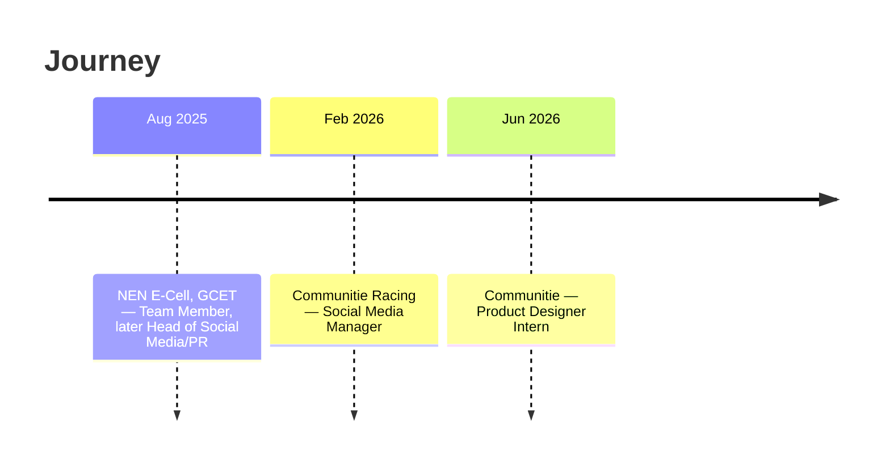

# Abhinaya Reddy

**CSE student · frontend & AI · building things that work end to end · Hyderabad**

## 🧭 About Me

> I turn ideas into products, from responsive web apps to AI systems, and I like talking to the people who'll use them.

- 🎓 3rd-year B.Tech CSE at **Geethanjali College of Engineering and Technology**, Hyderabad · top 2 in my program (Certificate of Merit)
- 🍯 Currently building **Honeycomb**, an offline-first RAG workbench for air-gapped industrial environments
- 🎤 Panel moderator, anchor and public speaker · Head of Social Media/PR at **NEN E-Cell, GCET**
- 📣 Social Media Manager & Head of Marketing at **Communitie Racing**
- 🎨 Product Designer Intern at **Communitie** (Jun–Jul 2026)
- 🏎️ Off-keyboard: F1 and Formula E, community building, creative content

## 🌟 Featured Projects

| 🍯 [Honeycomb](https://github.com/abhinayareddyyy/Lattice) **Offline-First RAG Workbench** Secure document interaction for air-gapped industrial environments. Hybrid retrieval (Qdrant dense search + BM25 + neural reranking), an agent step that verifies answers before they're returned, and multimodal OCR ingestion. Generates PDF, DOCX, XLSX and PPTX outputs. `Python` `FastAPI` `Qdrant` `Qwen` `OCR` `Agentic AI` | 🦾 [NeuroLift](https://github.com/abhinayareddyyy/NEUROLIFT) **Wearable for Foot-Drop Rehabilitation** IoT prototype fusing MPU6050 motion and EMG sensor data on a 100 ms real-time loop. Built with a team of three at the Geenovate 36-hour hackathon. `C++` `Arduino` `IoT` |
| :--- | :--- |
| 🍲 [HungerHeal](https://github.com/abhinayareddyyy/HungerHeal) **Food Rescue Platform** Connects donors, volunteers and NGOs to redistribute surplus food, with role-based workflows for each. `HTML` `CSS` `JavaScript`  | ✅ [MintyMind](https://github.com/abhinayareddyyy/MintyMind) **Smart Task Manager** Task scheduling with deadlines and priorities, using Design & Analysis of Algorithms concepts for smart scheduling. `HTML` `CSS` `JavaScript`  |

**📦 More:** [NetPulse (WiFi Troubleshooter)](https://github.com/abhinayareddyyy/WiFi-Troubleshooter) · [2048 in Java](https://github.com/abhinayareddyyy/2048-game-java) · [Creative Portfolio (Framer)](https://abhinayaaareddy.framer.website)

## 🛠️ Tech Arsenal

**Languages**

**Frontend, Backend & Data**

**AI / ML**: RAG · hybrid retrieval · agentic AI · prompt engineering

**Tools & Design**

**Salesforce**: 13 Trailhead badges, including Apex Triggers, Data Modeling and Flow Builder

## 💼 Experience & Leadership

## 🏆 Achievements & Participation

| | Recognition | Where |
| :-: | :-- | :-- |
| 🥇 | **Academic Topper**: top 2 students in B.Tech | GCET, 2026 |
| 🏅 | **Best TM Award** | NEN Cell, 2026 |
| 🎯 | **SIH Internal Round**: shortlisted for the final round | 2026 |
| 💻 | **Hackathons**: Geenovate 2K25 · Vaisheshika 2K25 | 2025 |
| 🎙️ | **Orientation Day Anchor** · Panel Discussion Moderator | GCET / NEN |
| 🤝 | **Volunteering**: NSS health & hygiene awareness · Bhaswara 2026 | |

## 📊 GitHub Analytics

## 💡 What I'm Good At

| Domain | Focus |
| :-- | :-- |
| 🧠 **LLM Applications** | RAG systems, hybrid retrieval, reranking, answer verification |
| 📄 **Document AI** | OCR ingestion, multi-format document generation |
| 🎨 **Frontend & UI/UX** | Responsive web apps, Figma, Framer |
| 🔌 **Embedded / IoT** | Sensor fusion, real-time loops, wearable prototypes |
| 📣 **Community & Content** | Social media, PR, marketing, moderating and anchoring events |

## 🤝 Let's Build Something

**Open to** AI/ML and software internships · collaborations · open source

